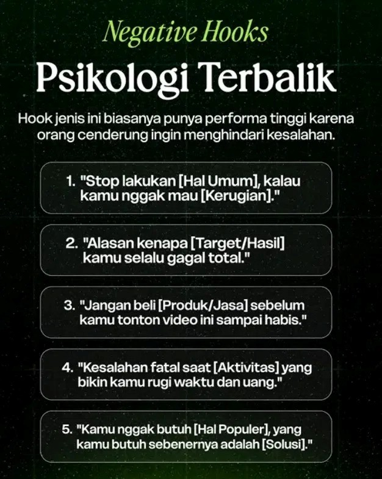
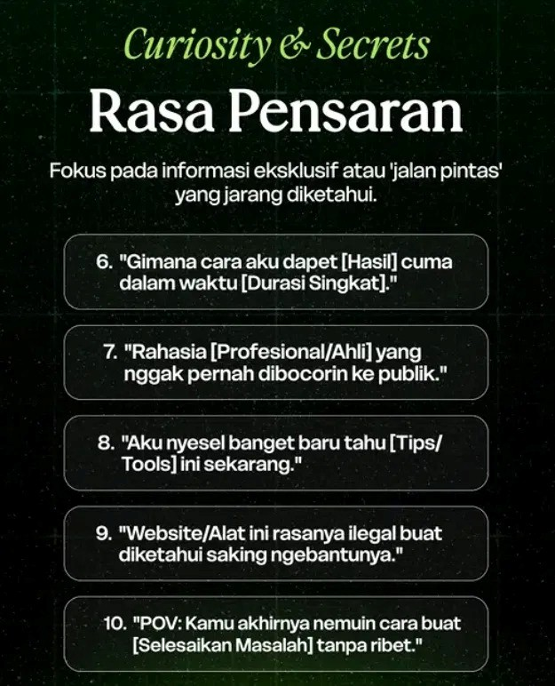
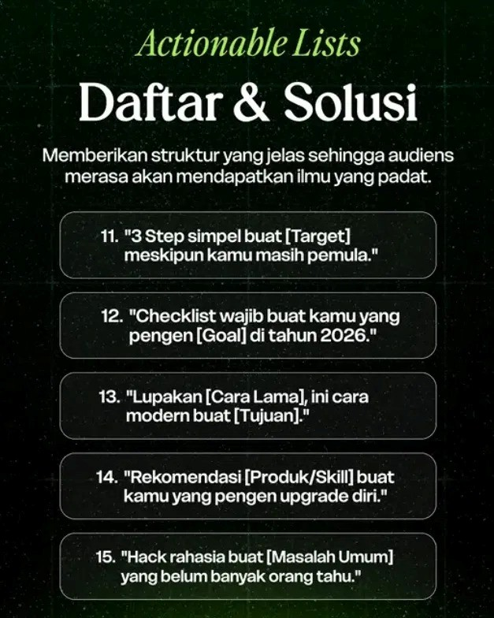
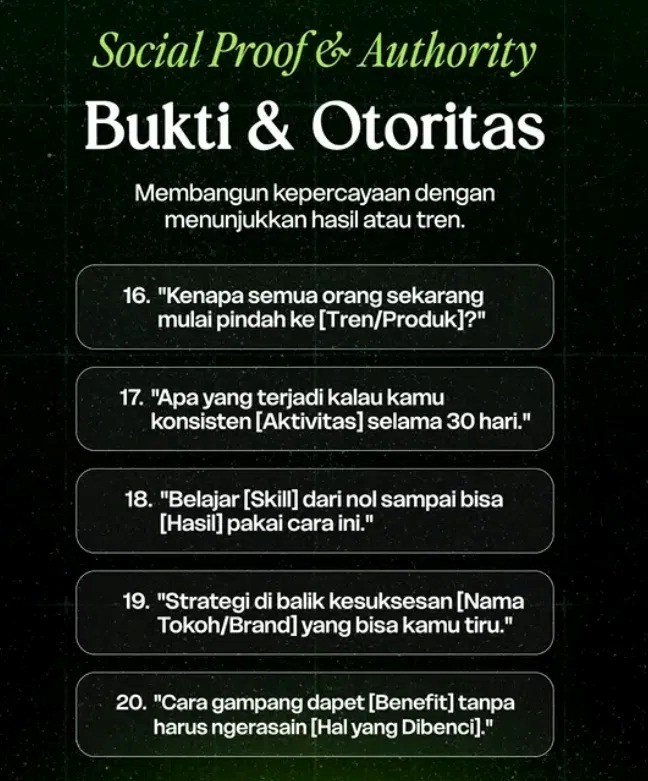

silahkan kamu pelajari dulu file pdf D:/code-for-life/inspiralabs/projects/ekskul-coding/docs/SILABUS EKSTRAKURIKULER SEM 1 TP.2026\_2027 - Google Sheets.pdf

disini kamu sebagai Master Kurikulum untuk materi pembelajaran di tingkat SMP dan SMA, pelajari dan fokus ke pertemuan 9 sampai 13

pembuatan materi di sesuaikan dengan tingkatan atau jenjang sekolah.

yang harus kamu hasilkan adalah

1. baca dan analisa dulu file pdf silabus yang saya kirim
2. jangan ekskusi apapun dahulu, kita akan berdiskusi untuk brainstorming materi P9-P13 dahulu untuk jenjang SMP dan SMA
3. berikan saran materi yang akan dibahas untuk P9-P13 SMP dan SMA
4. durasi materi yang dibahas adalah 70 menit
5. materi harus mengandung challange (easy, medium, dan hard)
6. buat 5 soal post test untuk tiap materi pertemuan hasil dari apa yang dipelajari dari materi lengkap/ppt, post-test adalah bagian dari pengajaran yang harus dikerjakan murid diakhir sesi pertemuan
7. untuk materi sebenarnya udah ada di dalam folder sma dan smp, silahkan di cek aja dulu
8. baca file SMP dan SMA yang saya kirim. file tersebut merupakan project akhir yang akan dikerjakan. kamu cukup fokus sebagai instruktur coding hardware atau iot untuk P9-P13. ide saya adalah ketika membahas materi hardware, materi yang dibahas itu brackdown dari project akhir, jadi agar mereka tidak kaget ketika dikasih file project akhir. jadi materinya adalah berjenjang pembahasan sebelum file final di project akhir. jadi tetap se arah dan to the point menuju materi akhir yang akan dibuat, namun tidak sama persis dengan project akhir. contoh: misalkan didalam project tersebut membahas cara membaca sensor dht22. cara membuat running led, berarti akan diberikan contoh pembahasan materi cara membuat pembacaan sensor, agar ketika di project akhir nanti kita kasih file untuk mereka eksekusi, mereka sudah paham "oh ini adalah komponen card, dan begini cara membuatnya begini cara mengubahnya begini cara menambahkannya".
9. untuk SMP. buat materinya semudah mungkin se awam mungkin, karna setelah 8 pertemuan ini daya tangkap SMP ini berbeda. artinya kamu harus memikirkan dengan matang tentang materi yang akan disampaikan agar tidak habis waktunya untuk debugging saja. kuncinya adalah materi tersampaikan dan mereka paham, tidak perlu ngebut mengejar materi, sedikit saja yang cukup untk 70 menitan. karna pasti ada fase erro atau tanya jawab dari murid yang juga memakan waktu. jadi materi ini harus efektif untuk murid usia 12-15 tahun. pastikan materinya lebih banyak berisi tantangan untuk keaktifan mereka namun tidak mengabaikan penyampaian pemahaman yang baik.
10. untuk SMA. materinya tingkatannya adalah mereka punya pemahaman lebih untuk coding. jadi materinya dibuat dengan cukup lebih dalam dibanding smp tidak apa. mereka punya kesiapan lebih untuk coding. pastikan materinya mencakup keaktifan murid selama 70menitan. materi harus efektif untuk murid usia 15-18 tahun.
11. isi challange bisa berupa melengkapi coding atau memperbaiki coding atau apapun tolong sarankan (bagi kedalam 3 tingkatan easy, medium dan hard)
12. pastikan isi post-test adalah hal hal yang sudah dibahas (ada di ppt)
13. sebenarnya uuntuk materi coding dan hardware iini sudah saya buatkan file atau bahan ajarnya, kamu pelajari dulu aja di folder smp dan sma.

perbaiki kualitas prompt saya. tanyakan dan konfirmasi dulu apapun untuk menyempurnakan diskusi kita. jadi urutan kita adalah diskusi materi+challange+post test P9-P19 SMP dan SMA. jika sudah oke maka ekskusi kedalam file MD dahulu.

---

khusus untuk materi PPT. disetiap pertemuan baik itu SMP atau SMA. pastikan ada slide yang isinya konten "daging". jadi inspiralabs ingin membuat konten sharing tips &amp; trick dari ekskul. namun tidak semua demi tetap membuat ekskul coding tetap eksklusif. namun pembagian ilmunya akan juga disharing di reels. saya punya rekomendasi hook. tolong pakai hook tersebut disetiap ppt pertemuan. hook tersebut merupakan tanda atau kode untuk tim inspiralabs siap record. pastikan materi yang disampaikan dalam hook merupakan materi penting yang sangat bermanfaat dan membantu di real industri berapapun usianya. setiap konten hook merupakan konten yang akan direkam jadi tolong siapkan materi dengan baik dalam ppt. pilih hook yang paling menarik dan sesuai. karna slide juga ditampilkan ke siswa,maka tampilannya juga harus menyesuaikan tema, dan hooknya juga yang membuat siswapun penasaran, dan scriptnya cukup ditulis di file docx saja. 

dan demi menghemat token. semua file mulai saat ini outputnya adalah file MD. nanti akan saya eksekusi di gemini AI pro untuk dijadikan file docx ataupun slide. kenapa saya minta jadi file md saja karna secara tema sudah sesuai dan masuk jadi tidak masalah. semuanya sudah oke, sisa tampilan di ppt dan isi script di docx yang perlu disesuaikan. dan script konten buat lebih daging lagi isinya, lebih tips n trick. pastikan materi antar smp dan sma berbeda karna akan jadi konten berbeda.

---

di akhir, sebelum kamu eksekusi, tolong rapikan struktur folder dan file yg ada di folder ekskul-coding ini.  
rapikan sebagaimana mestinya bebas menurut kamu aja. yang mataeri ajar itu tidak saling timpang tindih.

karena folder ini juga ada program untuk ke website leaderboard untuk anak anak di sekolah asy syahid.